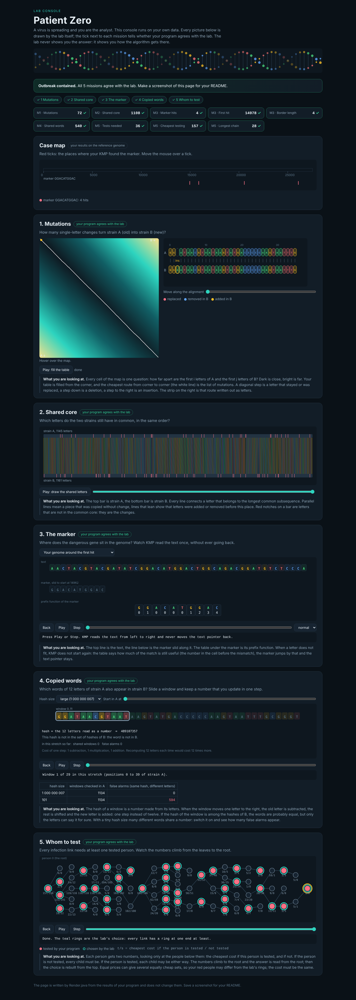

# Assignment 4. Patient Zero

| | |
|---|---|
| Student ID | 254188 |
| Name | Nurasyl Ilyas |
| Group | SE-2536 |
| Course | Design and Analysis of Algorithms |
| Language | Java 17+ |

An outbreak, a genome and a list of people to test. Every question of the lab is one algorithm of the course: edit distance and LCS (dynamic programming), the prefix function and KMP, Rabin-Karp with a rolling hash, and dynamic programming on a tree.

## How to run

```bash
java tools/MakeVariant.java 254188 data
```

```bash
javac -encoding UTF-8 -d out src/*.java
```

```bash
java -cp out Main
```

```bash
java tools/Check.java
```

```bash
java -cp out Bench
```

`Main` reads the four files in `data`, prints the 9 lines and writes the lab console `output/outbreak.html`. `Check` runs the program on the three examples (`tiny`, `small`, `dense`): all 27 lines are right. On my data the program finishes in well under one second.

## Where the code is

| Mission | File | Methods |
|---|---|---|
| 1. Mutations | `src/Strains.java` | `editDistance` |
| 2. Shared core | `src/Strains.java` | `lcsLength` |
| 3. The marker | `src/Marker.java` | `prefixFunction`, `findAll` (KMP) |
| 4. Copied words | `src/Marker.java` | `sharedWords`, `roll`, `sameLetters` (Rabin-Karp) |
| 5. Whom to test | `src/Outbreak.java` | `cheapestTests`, `longestChain`, `bfsOrder` |

No `indexOf`, `contains`, regular expressions, `split` or hashing libraries are used in the missions. The only library class is a `HashMap` that stores my own hash numbers.

## Program output

The 9 lines my program prints on my data (`java -cp out Main`):

    Mutations: 72
    Shared core: 1108
    Marker hits: 4
    First hit: 14978
    Border length: 4
    Shared words: 540
    Tests needed: 36
    Cheapest testing: 157
    Longest chain: 28

My data: strain A has 1145 letters, strain B has 1161, the genome has 27 548 letters, the marker is `GGACATGGAC`, and the tree has 80 people. The lab console shows a green tick for all 9 lines.

My outbreak report (a screenshot of `output/outbreak.html`):



## The tiny example by hand

Before writing code I checked the rules on `examples/tiny`:

- **Mutations = 1.** `ACGTACGTACGTAC` and `ACGTACGTACGTAG` differ only in the last letter: one replacement.
- **Shared core = 13.** The first 13 letters are the same, the last letters C and G are different.
- **Prefix function of `ACGAC`** = `[0, 0, 0, 1, 2]`, so **Border length = 2** (`AC` is at the start and at the end).
- **Marker hits = 2, First hit = 0.** `ACGAC` occurs in `ACGACGACGT` at 0 and at 3. The two hits overlap in `AC`, so after the first match KMP continues with k = 2, not with 0.
- **Shared words = 2.** Two 12-letter windows of A also occur in B.
- **Tests needed = 2, Cheapest testing = 6.** Links 0-1, 0-2, 1-3, 1-4, 2-5. Testing persons 1 and 2 covers every link, costing 2 + 4 = 6.
- **Longest chain = 4.** The path 3-1-0-2-5 has 4 links.

## Questions

**Mission 1. What does the cell d[i][j] of your table mean, and how is it computed from other cells?**

d[i][j] is the smallest number of changes that turn the first i letters of A into the first j letters of B. The first column is d[i][0] = i (delete all i letters) and the first row is d[0][j] = j (insert all j letters). For any other cell I look at the last step and take the smallest of three: d[i-1][j-1] + 0 if the letters are equal or + 1 if one is replaced, d[i-1][j] + 1 for deleting A[i-1], and d[i][j-1] + 1 for inserting B[j-1]. The answer is the corner d[n][m], which is 72 for my strains.

**Mission 2. How is the longest common subsequence different from the longest common substring? My Shared core is bigger than the number of letters that are the same at the same place: why?**

A substring is one unbroken block of letters. A subsequence may skip letters, as long as the order stays the same. My table L[i][j] is the LCS of the first i letters of A and the first j letters of B. If A[i-1] = B[j-1] it is L[i-1][j-1] + 1; otherwise it is the bigger of L[i-1][j] and L[i][j-1].

Only 310 positions of my strains have the same letter at the same index, but the Shared core is 1108. The reason is that strain B starts with one extra letter (`GGA` + `ATAACG...`), so the letters after it are shifted by one place, and later insertions and deletions shift them again. A comparison index by index loses all of them. The LCS lets the two strains slide against each other and still matches them.

**Mission 3. What does the prefix function tell you, and why does the pointer in the text never go back in KMP? What is the Border length of my marker and what does it mean?**

pi[i] is the length of the longest proper prefix of p[0..i] that is also a suffix of it. In KMP, k is the number of marker letters matched so far. When the next text letter does not fit, the last k letters of the text are p[0..k-1], and pi[k-1] says how many of them are already the start of the next possible match. So k jumps to pi[k-1] and i never moves back. Every step either moves i forward or makes k smaller, so the search is O(n + m).

My marker `GGACATGGAC` has Border length 4: `GGAC` is both its beginning and its end. After a full match, KMP continues with k = 4 instead of 0. A new occurrence could start only 6 letters later and overlap the previous one, and it would still be found.

**Mission 4. Why must you compare the letters after the hashes are equal? What happens to the cost of Rabin-Karp if many windows have the same hash?**

A hash puts a huge number of different words into a limited range of numbers, so two different words can get the same hash (a collision, a "false alarm"). Equal hashes only mean "maybe equal". Only a letter-by-letter comparison proves that the word of A really occurs in B. I tested this: with a tiny modulus MOD = 7 almost every window collides, and my answer stays the same because I compare the letters.

Each comparison costs k letters. If many windows have the same hash, the program compares all the time and the cost grows from O(n + m) towards O(n · m · k) in the worst case, slower than the naive search. A large prime modulus (I use 1 000 000 007) keeps collisions rare. The rolling hash itself is O(1) per step: remove the old letter times BASE^(k-1), multiply by BASE, add the new letter, and add MOD so the value is never negative.

**Mission 5. What are the two states of a person in your DP, and how do you get the answer for a person from its children? Why does a greedy "test the person with most links first" not always give the cheapest answer?**

I root the tree in person 0 (BFS, remembering the parent so I never walk back). For every person v I keep two numbers for the subtree of v:

- in[v] = the cheapest cost when v **is** tested = cost[v] + the sum over the children of min(in[c], out[c]). v already covers the link to each child, so each child takes its cheaper choice.
- out[v] = the cheapest cost when v is **not** tested = the sum over the children of in[c]. The link v–c must be covered, so every child must be tested.

I process the people from the leaves up, and the answer is min(in[0], out[0]). To rebuild who is tested, I go from the root down. The root takes its cheaper state, a child of a non-tested person is tested, and any other child takes its cheaper state.

Greedy fails because it decides by one local number and never reconsiders. For example, take a centre with 3 links and cost 100, connected to three leaves with cost 1 each. Greedy tests the centre and pays 100, but testing the three leaves covers the same links for 3. The DP compares both states of every person, so it always finds the minimum.

For the longest chain, down[v] is the longest way down from v. For every person I keep the two longest ways down through different children, and the longest chain through v is their sum. The answer is the biggest sum, 28 links for my tree.

## AI use

Tool: Claude

What I used it for: asking for ideas, guidance, and a step-by-step plan

## Timing (Mission 7)

Milliseconds, average of 3 runs, from `java -cp out Bench`.

| test | size | time (ms) |
|---|---|---|
| naive search | 20 000 / 40 000 / 80 000 | 39.6 / 84.8 / 191.4 |
| KMP | 20 000 / 40 000 / 80 000 | 1.4 / 1.8 / 0.4 |
| edit distance | 500 / 1000 / 2000 / 4000 | 5.6 / 8.8 / 22.4 / 107.9 |

**How the time grows.** The naive search about doubles when the text doubles (×2.1 and ×2.3), but it is already slow: at almost every position it compares nearly all 2000 letters of the pattern, which is O(n · m). KMP stays around one millisecond because it is O(n + m). At these sizes its times are mostly JVM warm-up and noise; the 80 000 run is even the fastest because the code is already compiled by then. The edit distance grows about ×4 when the length doubles (22.4 → 107.9 ms), as expected for an n × m table. The two smallest sizes are disturbed by warm-up.

## Complexity

n is the length of the text (or of a strain), m the length of the pattern (or of the other strain), k the length of the window, and v the number of people.

| algorithm | time | space | assumptions |
|---|---|---|---|
| Edit distance | O(n · m) | O(n · m) | full (n+1) × (m+1) table, O(1) work per cell; two rows would be enough for O(m) space |
| LCS | O(n · m) | O(n · m) | the same kind of table, O(1) work per cell |
| Prefix function and KMP | O(n + m) | O(m), plus the list of hits | every step moves i forward or makes k smaller, so all the inner `while` loops together do O(n + m) work |
| Rabin-Karp (shared words) | O(n + m) expected, O(n · m · k) worst case | O(m) for the hash map of B's windows | rolling hash is O(1) per window; k letters are compared only when the hashes are equal; a large prime modulus keeps collisions rare |
| Tree DP (testing and longest chain) | O(v) | O(v) | one BFS from person 0, then every person and every link is handled a constant number of times |

## Checklist

- [x] The four files in `data` and the screenshot `output/outbreak.png` are in the repository.
- [x] `java tools/Check.java` shows all examples right.
- [x] This README is filled in, including the program output and the AI use section.
- [x] The work is pushed to `main` with at least one commit per mission, and the repository is public.
- [ ] The link is attached in Moodle.